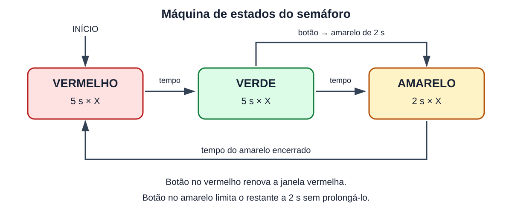
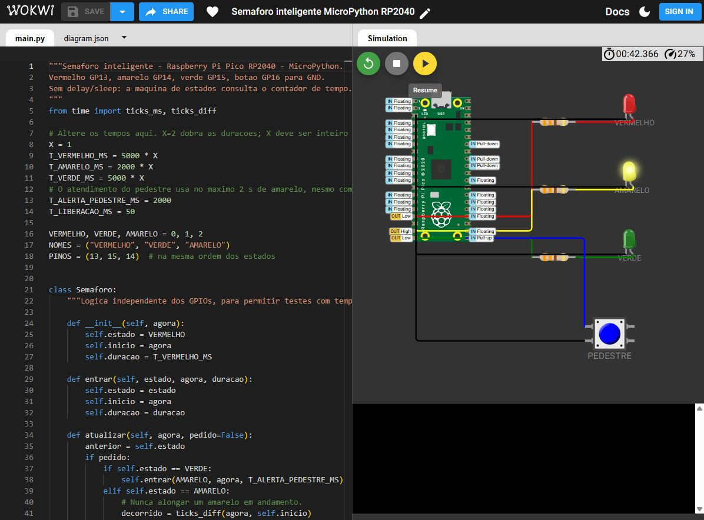

Semáforo inteligente com MicroPython

Comparação entre AVR de 8 bits e ARM Cortex M de 32 bits

Anhanguera
Sistemas Digitais e Microprocessadores
Atividade 01
Professor Marcel

Integrantes e RAs __________________________________________
Curso e turma ____________________________________________
Cidade __________________________ Ano _____________________


## Resumo


Este trabalho compara microcontroladores AVR de 8 bits e ARM Cortex-M de 32 bits e apresenta um semáforo didático no Raspberry Pi Pico RP2040. A implementação prática utiliza MicroPython no Wokwi, uma máquina de estados e consulta contínua ao contador de tempo, sem espera bloqueante. Um botão de pedestre gera uma interrupção e antecipa a passagem do verde para o amarelo.

A largura de palavra, o sistema de memória e os periféricos favorecem aplicações diferentes. O AVR é adequado a controles simples com poucos recursos. O ARM oferece maior capacidade de processamento e memória, mas o desempenho também depende da linguagem e das bibliotecas. No projeto, o acesso aos LEDs ocorre por registradores do RP2040, embora a execução permaneça interpretada.


## Objetivo e escopo


Relacionar arquitetura, memória, periféricos e programação ao controle de um semáforo. Os dispositivos de referência são o ATmega328P do Arduino Uno R3, o STM32F103C8 e o RP2040 do Raspberry Pi Pico. O Pico foi selecionado para a prática em Python e é um dos exemplos ARM admitidos no enunciado. [1–5]

A comparação experimental entre dois binários nativos AVR e ARM é distinta da implementação Python. O arquivo main.py não é um executável nativo; sua execução exige o firmware MicroPython. A seção de medição define como separar esses componentes e evita atribuir à arquitetura diferenças provocadas pelo interpretador.

Simulação do projeto: [wokwi.com/projects/479241493679592449](https://wokwi.com/projects/479241493679592449)
Código e materiais: [github.com/pablofalencar-dot/semaforo-inteligente-micropython](https://github.com/pablofalencar-dot/semaforo-inteligente-micropython)


---


## 1 Arquitetura da CPU


O ATmega328P possui uma CPU AVR RISC de 8 bits, com 32 registradores de trabalho de 8 bits. Sua organização Harvard separa os espaços de programa e dados. Instruções são normalmente codificadas em palavras de 16 bits, com algumas de 32 bits; portanto, CPU de 8 bits não significa instruções de 8 bits. A busca de programa e a execução se sobrepõem por pipeline. [1, 2]

Os Cortex-M possuem registradores de propósito geral de 32 bits e operam com o conjunto Thumb. O Cortex-M0+ do RP2040 implementa Armv6-M, enquanto o Cortex-M3 do STM32F103 implementa Armv7-M. Ambos são processadores de 32 bits, mas não têm exatamente as mesmas instruções ou o mesmo sistema de barramentos. [3, 4, 6]

Em uma soma de inteiros de 32 bits, o AVR precisa processar vários bytes e propagar o transporte entre eles. Em um Cortex-M, os operandos cabem em registradores de 32 bits e a soma pode ser executada por uma instrução aritmética, após os carregamentos necessários. A velocidade final também depende do clock, dos acessos à memória e do compilador; não decorre uma aceleração fixa de quatro vezes.

ATmega328P, Cortex-M0+ e Cortex-M3 não possuem FPU. Operações de ponto flutuante dependem de rotinas de software. Alguns Cortex-M4, M7 e M33 podem incluir FPU, conforme a implementação; o nome ARM, isoladamente, não garante esse recurso. Em Python, objetos e interpretação acrescentam custos que não existem da mesma forma em uma operação C nativa. [1, 3, 4, 6]


## Evolução da arquitetura ARM


A tabela resume marcos e perfis, sem tratar famílias diferentes como uma sequência única de substituição. Cortex-M é o perfil de microcontroladores; Cortex-A e Cortex-R atendem outras classes de aplicação. [6, 7]

| Arquitetura e exemplos | Características | Aplicações |
| --- | --- | --- |
| Armv4T e ARM7TDMI | ARM e Thumb; geração clássica de 32 bits | Sistemas embarcados tradicionais |
| Armv6-M e Cortex-M0 ou M0+ | Núcleo compacto; conjunto Thumb reduzido | Sensores e controle de baixo custo |
| Armv7-M e Cortex-M3 | Thumb-2 e interrupções integradas | Controle industrial e instrumentação |
| Armv7E-M e Cortex-M4 ou M7 | Extensões DSP; FPU conforme o núcleo | Motores e processamento de sinais |
| Armv8-M e Cortex-M23 ou M33 | Evolução de segurança; TrustZone conforme implementação | IoT e dispositivos com isolamento |
| Armv8.1-M e Cortex-M55 ou M85 | Extensões como Helium conforme o núcleo | DSP e aprendizado de máquina embarcado |
| Armv8-A e Armv9-A | Perfil de aplicações com AArch64 | Celulares, computadores e servidores |


---


## 2 Barramentos memória e periféricos


| Característica | Uno R3 ATmega328P | STM32F103C8 | Pico RP2040 |
| --- | --- | --- | --- |
| CPU | AVR de 8 bits | Cortex-M3 de 32 bits | Dois Cortex-M0+ de 32 bits |
| Clock | 16 MHz na placa | Até 72 MHz | Até 133 MHz especificados |
| SRAM | 2 KiB | 20 KiB | 264 KiB |
| Flash | 32 KiB interna | 64 KiB interna | 2 MiB externa na placa Pico |
| EEPROM | 1 KiB interna | Sem EEPROM dedicada | Sem EEPROM dedicada |
| ADC | 10 bits | 12 bits | 12 bits |
| DMA | Não possui | Possui | 12 canais no chip |
| Temporizadores | Dois de 8 bits e um de 16 bits | Gerais e PWM avançado | Contador de 64 bits e alarmes; PWM |
| CAN | Sem controlador integrado | Controlador CAN integrado | Sem controlador integrado |
| GPIO na placa | Lógica de 5 V | Lógica de 3,3 V | Lógica de 3,3 V |

Os valores são específicos dos dispositivos comparados, não de todos os AVR ou ARM. No Uno, parte da Flash é reservada ao bootloader. A Flash do RP2040 fica fora do chip e integra a placa Pico; instruções podem ser executadas por XIP, com cache. O clock consultado por machine.freq() pode ser 125 MHz no firmware MicroPython, abaixo do máximo especificado do RP2040. [1–5, 8]

No AVR, a separação dos espaços exige instruções próprias para ler constantes no programa. A SRAM guarda variáveis e pilha. No Cortex-M3, o mapa de endereços é unificado, mas há caminhos separados para busca de instruções e dados, associados a AHB e APB no STM32. Portanto, apresentar todo ARM como Von Neumann puro seria incorreto. [1, 3]

O RP2040 usa uma estrutura de interconexão com acesso a bancos de SRAM, periféricos e Flash externa. O Cortex-M0+ possui uma interface de barramento mais simples que a do M3. A separação em bancos reduz disputas entre mestres quando acessam bancos diferentes. A latência de memória e a contenção podem afetar a execução. [4]

DMA transfere dados sem uma instrução da CPU para cada item. Timers geram referências de tempo e PWM controla sinais periódicos; CAN requer também o transceptor físico para uma rede real. O semáforo usa apenas GPIO, contador de tempo e interrupção externa. No Wokwi, o Pico simula um único núcleo, e a simulação de DMA tem limitações; esses recursos não são usados pelo programa. [3, 4, 9]


---


## 3 Ecossistema de programação e acesso ao hardware


Arduino IDE é um ambiente de desenvolvimento e usa um núcleo de bibliotecas C/C++ que oferece funções como pinMode, digitalWrite e millis. A abstração simplifica a programação e a portabilidade, mas inclui traduções de pinos e outras verificações. Acesso direto a registradores também é possível no AVR; não é exclusividade de ARM. [10, 11]

No ecossistema ARM, C embarcado permite controlar registradores e interrupções. CMSIS padroniza interfaces do núcleo, tipos e acesso a recursos como NVIC e SysTick. Bibliotecas HAL oferecem uma camada mais alta para periféricos de um fabricante. Assim, HAL e registradores diretos representam níveis diferentes de abstração; usar HAL não significa necessariamente acessar cada registrador manualmente. [12]

MicroPython implementa uma linguagem de alto nível para microcontroladores e disponibiliza Pin, ticks_ms, ticks_diff e mem32. Ele facilita a demonstração, porém ocupa memória com interpretador, heap e objetos. A máquina de estados é Python; a configuração inicial de pinos usa Pin e a mudança das saídas usa acesso direto aos registradores SIO do RP2040. [8, 13–15]


## Registradores em comparação com digitalWrite


No núcleo AVR oficial, digitalWrite resolve o número do pino em porta e máscara, trata o vínculo com PWM e protege a atualização da porta. Uma escrita direta em um registrador específico pode evitar parte desse trabalho. O número exato de instruções depende da otimização e precisa ser confirmado no assembly do executável. [11]

No STM32F103, GPIOA->BSRR permite definir e limpar bits por uma escrita: a metade inferior seleciona bits a ligar e a superior seleciona bits a desligar. Exemplo conceitual em C: GPIOA->BSRR = (1u << 0) | (1u << (1 + 16)); liga PA0 e desliga PA1. Isso requer habilitar o clock e configurar previamente os pinos. Esse registrador não existe com o mesmo endereço no RP2040. [3, 16]


```python
# Trecho real do programa Python para RP2040
GPIO_OUT_SET = 0xD0000014
GPIO_OUT_CLR = 0xD0000018
MASCARA_LEDS = (1 << 13) | (1 << 14) | (1 << 15)
mem32[GPIO_OUT_CLR] = MASCARA_LEDS
mem32[GPIO_OUT_SET] = 1 << PINOS[estado]
```


As duas escritas apagam as três cores e acendem a selecionada, evitando sobreposição. Cada registrador SET ou CLR altera apenas os bits da máscara sem leitura anterior. A sequência inteira não é uma única escrita atômica: há um breve intervalo apagado. Como o interpretador executa as expressões Python, não se pode concluir que as duas linhas equivalem a duas instruções da CPU ou que superam digitalWrite em tempo total. [4, 15]


---


## 4 Projeto prático no Wokwi


O circuito contém Raspberry Pi Pico RP2040, três LEDs, três resistores de 330 ohms e um botão momentâneo. Cada GPIO alimenta o ânodo de um LED por seu resistor; o cátodo vai ao GND. O botão conecta GP16 ao GND quando pressionado e utiliza o pull-up interno. Os pinos GP são identificadores lógicos, não os números físicos do conector. [9, 17, 19]

| Elemento | Ligação | Função |
| --- | --- | --- |
| LED vermelho | GP13 ao resistor e ânodo; cátodo ao GND | Parada dos veículos |
| LED amarelo | GP14 ao resistor e ânodo; cátodo ao GND | Transição de atenção |
| LED verde | GP15 ao resistor e ânodo; cátodo ao GND | Passagem dos veículos |
| Botão | Contato 1 ao GP16; contato 2 ao GND | Pedido de pedestre por borda de descida |

O estado inicial é vermelho. O ciclo normal é vermelho por 5 s, verde por 5 s e amarelo por 2 s. X multiplica os tempos normais e deve permanecer inteiro positivo. O intervalo amarelo de atendimento ao pedestre é limitado a 2 s, mesmo quando X é maior que 1.


## Diagrama de estados




Transições por botão: no verde, entrar no amarelo de atendimento; no amarelo, preservar o prazo mais curto entre o restante atual e 2 s; no vermelho, renovar a janela vermelha. Essas duas últimas condições são transições para o próprio estado e estão descritas também no diagrama SVG fornecido.

No verde, o amarelo é a resposta imediata ao pedido. Após o intervalo de alerta, o vermelho libera a janela de travessia neste modelo didático. O enunciado pede amarelo/vermelho em até 2 s; a solução responde com amarelo no próximo ciclo do programa. O vermelho acontece após os 2 s de amarelo, acrescidos da latência. Não se declara uma garantia formal de tempo real estrito para MicroPython.


---


## 5 Temporização interrupção e organização do código


A classe Semaforo armazena estado, instante de entrada e duração. A cada passagem do laço, atualizar compara o tempo transcorrido com a duração. O programa não usa delay, sleep nem uma espera ocupada para completar cada intervalo; o laço consulta o tempo e continua verificando eventos. Ainda há consumo contínuo da CPU por polling, portanto não é uma estratégia de baixo consumo.


```python
if ticks_diff(agora, self.inicio) >= self.duracao:
    # Selecionar o proximo estado e registrar a entrada.
    ...
```


ticks_ms fornece a contagem temporal do sistema, apoiada pelo firmware e pelos recursos de temporização do port RP2. Não é necessário reconfigurar o SysTick usado pelo ambiente. ticks_diff realiza a diferença modular; a comparação continua válida ao retornar a zero, desde que o intervalo observado fique dentro de metade do período do contador. [8, 14]

O GPIO do botão dispara uma interrupção de hardware na borda de descida. A rotina hard=True apenas atribui 1 a uma flag global. Não altera os LEDs, não imprime e não aloca estruturas. O laço principal copia e limpa a flag em uma seção crítica curta, preservando o estado anterior de habilitação das interrupções. Essa separação reduz o trabalho dentro da ISR. [13, 15]

Após aceitar um pedido, o programa desarma temporariamente o botão. O rearme exige nível alto contínuo por 50 ms, verificado sem bloquear. Oscilações mecânicas durante o aperto ou a soltura não devem criar pedidos sucessivos. Um botão mantido pressionado gera um único atendimento; um novo pedido exige a soltura estável.


## Arquivos e procedimento de execução


O arquivo main.py contém a aplicação completa, sem bibliotecas externas. diagram.json descreve os componentes e ligações. Deve-se abrir o modelo oficial MicroPython para Raspberry Pi Pico, substituir integralmente esses dois arquivos e iniciar a simulação. A documentação do Wokwi informa que main.py é executado automaticamente. [17, 18]

Modelo: [https://wokwi.com/projects/new/micropython-pi-pico](https://wokwi.com/projects/new/micropython-pi-pico)

Na demonstração, observar ao menos um ciclo normal e depois apertar o botão durante o verde. Verificar também pedido no amarelo, pedido no vermelho, botão mantido e novos pedidos após soltura. Alterar X permite demonstrar configuração, mantendo X = 1 na apresentação dos tempos originais.


## Critérios de funcionamento


Somente uma cor deve permanecer acesa. A sequência normal deve respeitar 5 s, 5 s e 2 s de tempo simulado. O pedido no verde deve iniciar o amarelo prontamente. Pedidos no amarelo não devem adiar o vermelho. O pedido no vermelho deve renovar sua janela. As observações devem usar o relógio da simulação, pois uma simulação lenta no navegador pode não acompanhar o tempo de parede.


---


## 6 Tamanho de código e comparação experimental


Um relatório comparativo precisa distinguir arquitetura da CPU, linguagem e ambiente de execução. Comparar um sketch AVR nativo com apenas os bytes do arquivo Python mede objetos diferentes. A aplicação Python depende do interpretador e do sistema de arquivos. O contêiner UF2 também não corresponde diretamente à ocupação útil de Flash.

Para atender à comparação quantitativa, o anexo comparativo.ino implementa a mesma sequência e atendimento ao botão nas duas plataformas. O AVR usa digitalWrite; o RP2040 usa registradores SIO nas saídas. A prática principal permanece em MicroPython. As duas versões nativas foram compiladas com sucesso no GitHub Actions, execução número 1, em 29 de outubro de 2026, commit 6b10f15.

| Métrica em bytes | AVR ATmega328P | ARM RP2040 |
| --- | --- | --- |
| text reportado pelo GNU size | 1740 | 315244 |
| data inicializada | 24 | 12032 |
| bss não inicializada | 20 | 6652 |
| Flash estimada por text + data | 1764 | 327276 |
| RAM estática por data + bss | 44 | 18684 |

A medição usa avr-size -B e arm-none-eabi-size -B nos respectivos arquivos ELF. O campo text do formato Berkeley agrega código e outras seções somente de leitura consideradas pelo GNU size; não é apenas a seção chamada .text. RAM estática não inclui a necessidade de pilha ou heap. O tamanho do arquivo ELF em disco, com símbolos e metadados, também não corresponde à ocupação de Flash.

Ambiente reproduzível: Arduino CLI 1.3.1; Arduino AVR Boards 1.8.6, alvo arduino:avr:uno; Arduino-Pico 6.1.0, alvo rp2040:rp2040:rpipico. Foram usadas as opções padrão de cada core, sem mensagens seriais no sketch. O workflow registra as versões e preserva os binários e as medições no artefato binarios-e-medicoes. O script medir_binarios.py extrai os números diretamente dos ELF.

O firmware ARM é maior neste ensaio, embora tenha CPU mais larga. O total inclui a infraestrutura e as bibliotecas selecionadas por cada core Arduino. Portanto, esse resultado compara as duas implementações e seus ambientes, não comprova que ARM produz sempre código maior nem mede a eficiência isolada da ISA. Menos chamadas de abstração no GPIO não implica menor firmware completo.

O fonte Python possui 3946 bytes em UTF-8; esse valor é apresentado separadamente e não foi usado como binário ARM. A memória total da prática Python inclui o firmware MicroPython e o sistema de arquivos. Para medir velocidade de GPIO, seria necessário um ensaio adicional por analisador lógico ou inspeção do assembly; o tempo do navegador não mede instruções.

Resultado e evidência de compilação: [abrir execução 40933590494 no GitHub Actions](https://github.com/pablofalencar-dot/semaforo-inteligente-micropython/actions/runs/40933590494). Os valores também constam de medicoes_nativas.json no repositório.


---


## 7 Verificação e limites da evidência


O pacote inclui testes automáticos da máquina de estados, limites dos intervalos, pedidos em cada cor, retorno a zero do contador, limite do atendimento com tempos configurados, estrutura do circuito e integração com stubs de GPIO e interrupção. A integração verifica as escritas SET/CLR, ausência de duas cores simultâneas e comportamento do debounce. O resultado local é registrado em resultado_testes.txt.

A prática foi também aberta e executada no Wokwi com o ambiente micropython-20260406-v1.28.0. Foram observadas as três cores no ciclo normal, sem traceback no terminal, e o botão foi acionado durante o verde para verificar a antecipação do amarelo, seguida de vermelho. O projeto salvo está disponível no link da primeira página.

| Registro visual | Observação |
| --- | --- |
| Ciclo normal | Vermelho inicial, verde antes de 10 s e amarelo a 10,200 s |
| Verde antes do pedido | Estado verde observado a 41,333 s de simulação |
| Após pressionar o botão | Amarelo a 42,366 s, antes do fim normal do verde |
| Continuidade do atendimento | Vermelho observado a 44,966 s |

As capturas são observações pontuais e não medem o instante exato das bordas. A duração prevista pelo código é verificada nos testes locais; pausas e lentidão do navegador impedem usar esses registros como garantia de latência máxima de hardware.



Figura 2  Projeto em execução com amarelo antecipado pelo botão de pedestre


---


## 8 Conclusão


O semáforo mostra que uma máquina de estados pode organizar o controle temporal sem suspender o processamento por todo o intervalo de cada sinal. O botão por interrupção permite registrar o evento enquanto o laço principal aplica as transições e filtra a repetição do contato. A implementação em MicroPython atende à escolha de linguagem da prática e permite demonstrar acesso a GPIO por registradores no RP2040.

O AVR de 8 bits atende controles pequenos, enquanto os Cortex-M ampliam a capacidade de processamento, memória e integração de periféricos. Entretanto, largura de palavra, clock e recursos de hardware não bastam para prever a velocidade de uma aplicação interpretada. Uma avaliação quantitativa requer implementações equivalentes e medição documentada dos executáveis e do ambiente de execução.


## Referências


[1] Arduino. UNO R3 datasheet. https://docs.arduino.cc/resources/datasheets/A000066-datasheet.pdf

[2] Microchip. ATmega328P e documentação do dispositivo. https://www.microchip.com/en-us/product/ATmega328P

[3] STMicroelectronics. STM32F103x8 e STM32F103xB datasheet. https://www.st.com/resource/en/datasheet/stm32f103cb.pdf

[4] Raspberry Pi. RP2040 datasheet e mapa SIO. https://datasheets.raspberrypi.com/rp2040/rp2040-datasheet.pdf

[5] Raspberry Pi. Catálogo de placas e especificações Pico. https://datasheets.raspberrypi.com/product/product-catalogue-2023.pdf

[6] Arm. Arquiteturas e núcleos suportados. https://developer.arm.com/Tools%20and%20Software/Arm%20Toolchain%20for%20Embedded

[7] Arm. CPU Architecture e perfis A R M. https://www.arm.com/architecture/cpu

[8] MicroPython. Quick reference for the RP2. https://docs.micropython.org/en/latest/rp2/quickref.html

[9] Wokwi. Referência Raspberry Pi Pico e limites da simulação. https://docs.wokwi.com/parts/wokwi-pi-pico

[10] Arduino. Language Reference. https://docs.arduino.cc/language-reference/

[11] Arduino. Código fonte de wiring_digital.c. https://github.com/arduino/ArduinoCore-avr/blob/master/cores/arduino/wiring_digital.c

[12] Arm. CMSIS Core Overview. https://arm-software.github.io/CMSIS_5/Core/html/

[13] MicroPython. machine.Pin e interrupções. https://docs.micropython.org/en/latest/library/machine.Pin.html

[14] MicroPython. time e aritmética modular de ticks. https://docs.micropython.org/en/latest/library/time.html

[15] MicroPython. machine e acesso à memória. https://docs.micropython.org/en/latest/library/machine.html

[16] STMicroelectronics. RM0008 reference manual GPIO e BSRR. https://www.st.com/resource/en/reference_manual/cd00171190.pdf

[17] Wokwi. MicroPython on Wokwi. https://docs.wokwi.com/guides/micropython

[18] Wokwi. Formato diagram.json e referência do botão. https://docs.wokwi.com/diagram-format

[19] Wokwi. Pushbutton e contatos elétricos. https://docs.wokwi.com/parts/wokwi-pushbutton

Documentação consultada em 29 de outubro de 2026. As páginas latest do MicroPython descrevem a linha em desenvolvimento; a versão utilizada no simulador deve ser registrada na apresentação.